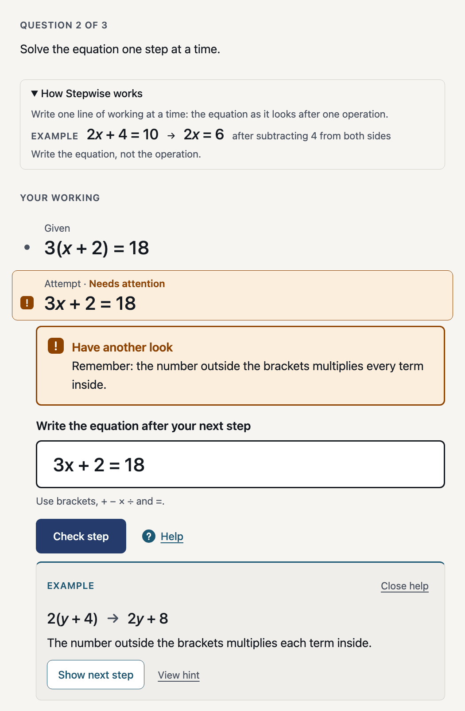
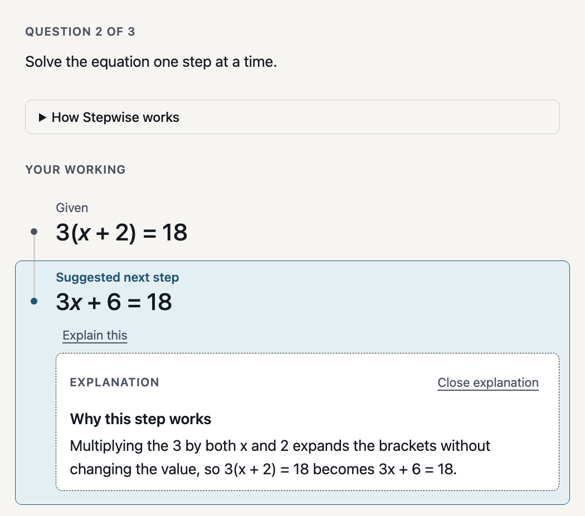
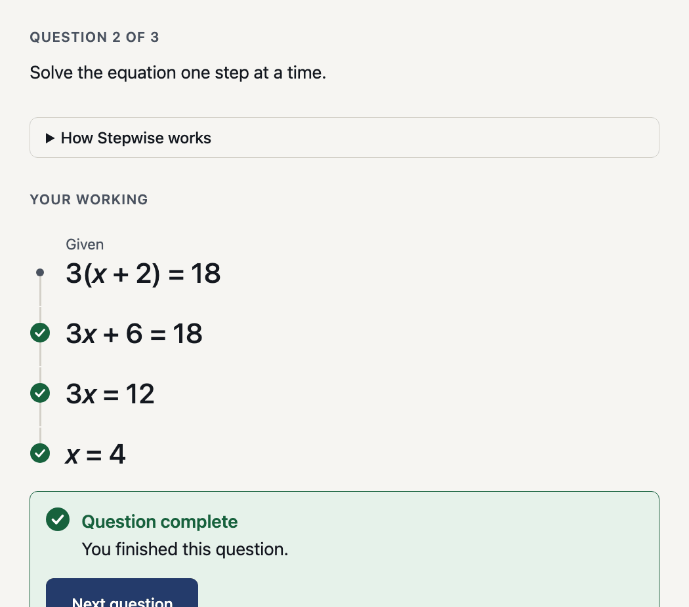
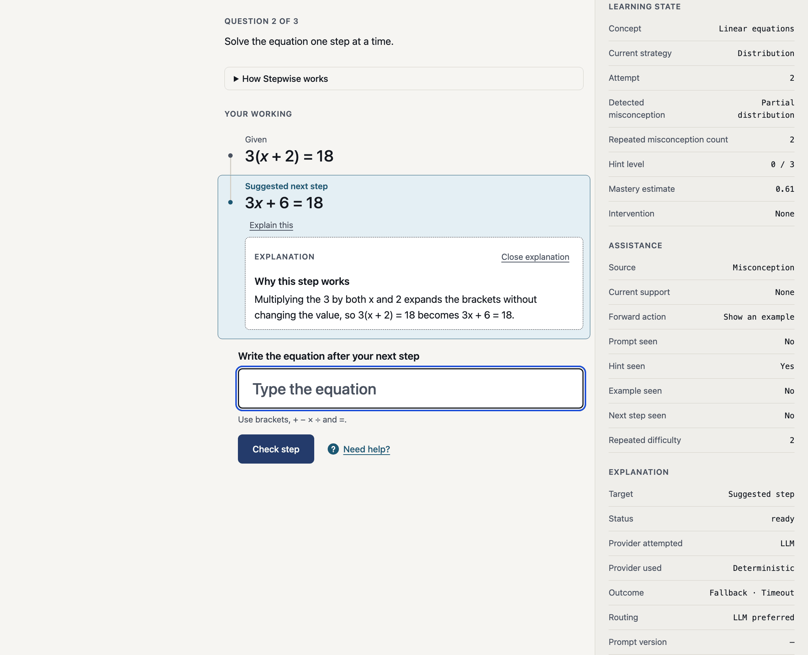
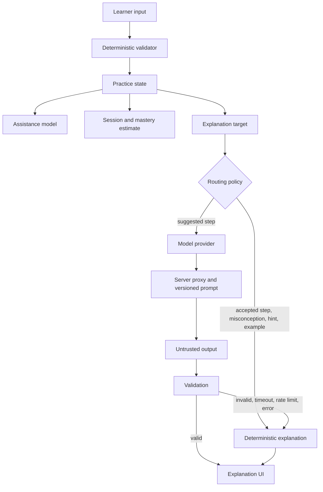

# Stepwise

An adaptive maths-practice prototype that reveals the right amount of help at the right time.

Stepwise explores how a learning interface can maintain rich internal state while exposing only the support a learner currently needs. The topic is deliberately narrow (linear equations, three questions) so the interaction and system design can be examined closely.



## What this demonstrates

- **Continuous step-by-step working.** The given line, the learner's accepted steps and any system-suggested step read as one piece of reasoning, with authorship and uncertainty kept visibly distinct.
- **Deterministic maths.** Validation, equivalence, misconception detection and completion use no maths library and no AI.
- **Progressively exposed help.** Prompt, Hint, Example and Suggested next step escalate by explicit rules, one forward action at a time, in one compact surface.
- **Progress is not mastery.** Visible question progress is separate from a hidden, illustrative mastery estimate.
- **Model-backed explanations behind a narrow boundary.** A model may word an explanation; it never judges, diagnoses or advances.
- **Evaluation-driven routing.** The model was compared with the deterministic baseline, and is used only where review showed added value.

## Product principles

- Progress is not mastery.
- Unrecognised does not mean wrong.
- The system may know more than the learner needs to see.
- Help should escalate deliberately.
- AI may explain the system's judgement; it does not make the judgement.
- Model use must demonstrate value over deterministic behaviour.

## Try it

```bash
npm install
npm run dev
```

No deployed URL exists yet (see [deployment notes](#deployment-status)). Everything runs locally and works without any API key.

| Route | What you get |
| --- | --- |
| `/` | The clean learner experience |
| `?inspector=1` | Learner experience plus the internal state (assistance, session, explanation provider, routing, cache) |
| `?dev=1` | Development navigation: Live, Inspector toggle and static previews |
| `?state=01` … `?state=17` | Static visual reference states (disabled controls, banner): untouched, accepted, misconceptions, unrecognised, Prompt / Hint / Example, Suggested next step, completion, explanations, provider fallback |

## Five-minute tour

1. Open `/?inspector=1` and solve Question 1 normally: `x + 2 = 6`, then `x = 4`.
2. Reload and enter `3x + 2 = 18` to see misconception handling. It is a recognised mistake; `6 + 3x = 18` is merely unrecognised and gets neutral wording.
3. Open **Need help?** and step through **Get a hint**, **Show an example** and **Show next step**. Watch the inspector's assistance section change while the learner UI stays small.
4. Press **Explain this** on the Suggested next step. With a key configured this is the one place the model is tried first; without one the deterministic explanation appears. Either way the inspector shows provider, routing and outcome.
5. Open `?state=17` for a provider fallback example, then read [Model evaluation](#model-evaluation).

### More screenshots

Static reference states (cropped from `?state=` previews):

| Suggested next step, with an explanation | Question complete |
| --- | --- |
|  |  |



## Architecture



| Trusted and deterministic | Untrusted | Validated model output |
| --- | --- | --- |
| Maths validation, canonical state, misconception detection, assistance escalation, question completion, mastery estimate | The wording a model returns | Title, body and an optional example, as plain text |

The explanation output schema has **no fields** for correctness, misconception, next step, progress or mastery, and the validator rejects unknown fields, so a model cannot influence any of them. Technical detail: [docs/EXPLANATION_MODEL_BOUNDARY.md](docs/EXPLANATION_MODEL_BOUNDARY.md).

## Model evaluation

- **Model:** `claude-haiku-4-5-20251001` · **Prompt:** `explanation-prompt/1` · **Corpus:** 12 cases (11 supported, 1 unsupported)
- **Reviewed result (prompt V1): Better 2 · Same 5 · Worse 4**
- **Caveat:** the Better / Same / Worse review was performed by an AI assistant and has not yet been independently validated by a human.

**Finding.** The model added value on Suggested next step explanations (2 of 2): it explained why a step is taken. Deterministic explanations were equal or better everywhere else. Routing is therefore hybrid: model first only for Suggested next step, deterministic for accepted steps, misconceptions, hints and examples, with deterministic fallback on every model route. The sample is small (two suggested-step cases, one run each), so this is evidence-informed, not proof.

**Latency.** Model calls took about 2 s at the median (successful calls, V1) against effectively zero for deterministic text, so the model has to earn that delay and its extra failure modes.

**Prompt V2** was written to stop the model putting future results in the optional `example` field. It removed that failure but regressed the two cases where V1 had added value and fixed none of the other recurring weaknesses, so it was evaluated and not adopted.

### What the model got wrong

- Dropped the negative sign in a Q3 bracket explanation ("the x and the 1").
- Gave a generic, content-free explanation of an arithmetic error.
- Ignored the learner's equivalent form `2x = 17 - 5`.
- Put future results in the optional `example` field in 4 of 10 V1 outputs (not displayed by the UI).
- V2 fixed the example leakage but caused other regressions.

Full evidence: [docs/EXPLANATION_EVALUATION.md](docs/EXPLANATION_EVALUATION.md). Narrative: [docs/CASE_STUDY.md](docs/CASE_STUDY.md).

## Engineering safeguards

- API key is server-side only; the client cannot send prompts, only a structured explanation request
- Versioned prompt registry and a structured response schema, validated on the server and again in the browser
- Deterministic fallback, timeout handling, rate limiting, request dedupe and a bounded cache
- Offline test suite; the live model evaluation is a separate, opt-in command

## Verification

- 486 tests, TypeScript typecheck and production build pass
- The normal test suite never calls a model; the deterministic evaluation is offline
- Live model evaluation is opt-in and uses the API

```bash
npm test                          # tests (offline)
npm run typecheck
npm run build
npm run eval:explanations         # deterministic baseline, offline
npm run eval:explanations:llm     # also evaluates the configured model (uses the API)
npm run eval:explanations:review  # writes a human-review file to evaluation-output/
npm run mock:llm                  # local stand-in for the model API
```

## Optional model configuration

```bash
cp .env.example .env
# set EXPLANATION_PROVIDER=llm and LLM_API_KEY=... (server-only; never prefix with VITE_)
```

The same handler runs locally as Vite middleware and as Cloudflare Pages Functions (`functions/api/`). Limits are tunable in `.env.example` and are in-memory and per instance.

## Accessibility and known limitations

Keyboard-only use works end to end (submit with Enter, Tab to Help, Explain this and their close actions), feedback never relies on colour alone, touch targets are at least 44px, and the static states were checked at 390px with no horizontal overflow. Known gaps: help and explanation bodies are polite live regions, so reopening seen content may be announced again by some screen readers; there has been no testing with real screen readers or learners; the Better / Same / Worse review awaits human validation; the mastery estimate is illustrative only.

## Deployment status

The Cloudflare adapter exists but has **not been deployed or production-tested**, and no git remote is configured. Remaining: create the Pages project, set the server-side secrets, configure `dist` as the build output, verify the Functions routes, and test rate-limit and cache behaviour live (state is per isolate).

## Documents

- [docs/CASE_STUDY.md](docs/CASE_STUDY.md): the product story
- [docs/EXPLANATION_MODEL_BOUNDARY.md](docs/EXPLANATION_MODEL_BOUNDARY.md): the technical model boundary
- [docs/EXPLANATION_EVALUATION.md](docs/EXPLANATION_EVALUATION.md): evaluation evidence
- [docs/PORTFOLIO_SUMMARY.md](docs/PORTFOLIO_SUMMARY.md): short copy for a portfolio site
- Design: [Figma](https://www.figma.com/design/DbgJ4GfXerydrZzYUhEvol)

## Stack

React, TypeScript, Vite, CSS Modules, Vitest and React Testing Library. No runtime dependencies beyond React.
